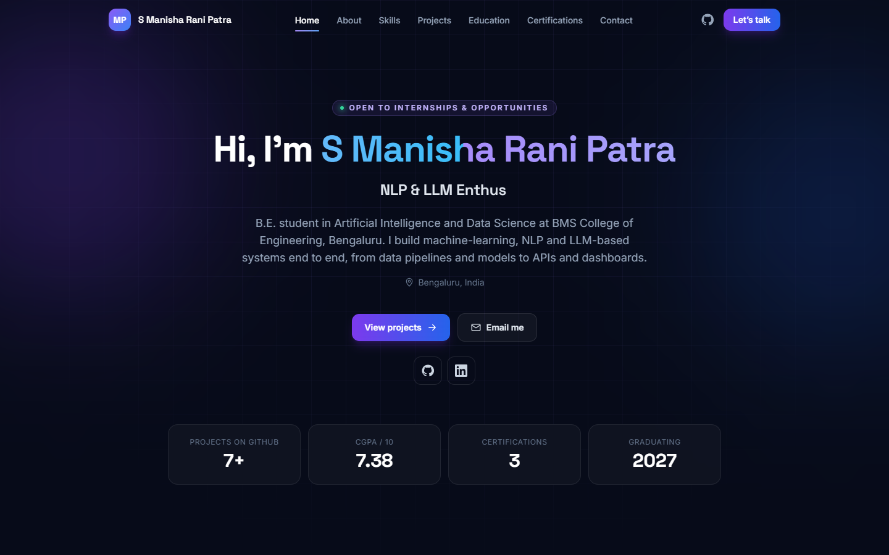

# S Manisha Rani Patra · Portfolio

Personal portfolio website of **S Manisha Rani Patra**, an Artificial Intelligence & Data Science student at BMS College of Engineering, Bengaluru (2023 – 2027).

Built with **React 18 + Vite 5 + Tailwind CSS 3**. It has a dark navy theme with purple and blue accents, scroll-reveal animations, a responsive layout, interactive project cards (category filter, tilt and glow, detail modal), and links to GitHub, LinkedIn and email.



## Sections

Home · About Me · Technical Skills · Projects · Education · Certifications · Contact

All content lives in one file, [`src/data/profile.js`](src/data/profile.js). It comes from the resume and the public GitHub repositories:

- [TrustGuard](https://github.com/manisha2001-20/TrustGuard)
- [Personalized AI News Digest Agent](https://github.com/manisha2001-20/ai-news-digest-agent)
- [Bias Detection & Fairness Evaluation Framework](https://github.com/manisha2001-20/bias-fairness-evaluation)
- [LearnNet Analyzer](https://github.com/manisha2001-20/learnnet-analyzer)
- [Fraud Detection in Financial Transactions](https://github.com/manisha2001-20/fraud-detection-transactions)
- [Smart Canteen Management System](https://github.com/manisha2001-20/smart-canteen-agent)
- [Electricity Bill Calculator using PyTest](https://github.com/manisha2001-20/Electricity_Bill_PyTest_Project)

## Run locally

Requires Node.js 18 or newer.

```bash
npm install
npm run dev        # http://localhost:5173
npm test           # content checks (exact name, personal email only, valid repo links, resume facts)
npm run build      # production build in dist/
npm run preview    # serve the build on http://localhost:4173
```

Optional browser check (Playwright): `python scripts/e2e_check.py http://localhost:4173/`. It covers every section, navigation, the project filter and modal, the mobile menu, horizontal overflow, broken images and external links, at desktop, tablet and mobile widths.

## Resume download button

The **Download resume** button appears only when `public/resume.pdf` exists, so a broken link never goes live. To enable it, add your resume as `public/resume.pdf`, then commit and push.

## Deploy

### Vercel (recommended)

1. Sign in at https://vercel.com with GitHub.
2. Click **Add New… → Project** and import `manisha2001-20/manisha-portfolio`.
3. Vercel detects Vite (also set in `vercel.json`): build command `npm run build`, output directory `dist`. Leave `BASE_PATH` unset.
4. Click **Deploy**. Every push to `main` then redeploys automatically.

Or from the command line: `npm i -g vercel && vercel login && vercel --prod`.

### GitHub Pages

`.github/workflows/deploy-pages.yml` tests, builds (with `BASE_PATH=/manisha-portfolio/`) and publishes the site on every push to `main`. The site is at https://manisha2001-20.github.io/manisha-portfolio/.

## Project structure

```
src/
├── data/profile.js        # all content (edit this)
├── components/            # Navbar, Hero, Projects (cards + modal), Sections (About, Skills, Education, Certifications, Contact, Footer), Icons
├── hooks.js               # scroll reveal, active section, typewriter, resume availability
├── App.jsx, main.jsx, index.css
tests/content.test.js      # Vitest content checks
scripts/e2e_check.py       # optional browser check
```
